# Crackscan: CNN Surface Crack Detection

A full-stack Deep Learning application designed for industrial surface inspection. It uses a custom Convolutional Neural Network (CNN) to detect structural cracks in concrete and metal surfaces. 

The application features a modern, responsive web interface that allows users to either upload high-resolution static images or use a real-time live camera feed to detect cracks instantly.



## 🏗️ Architecture

The project follows a classic **Three-Tier Architecture**:

1. **Client (Frontend):** React + TypeScript + Vite. Handles the UI, camera stream (`getUserMedia`), and canvas frame extraction.
2. **Server (Backend):** FastAPI + Uvicorn. Handles HTTP POST for file uploads and WebSockets for real-time frame streaming. Uses OpenCV for image preprocessing.
3. **Brain (Model):** TensorFlow / Keras. A custom CNN trained from scratch to classify `128x128` images as "Crack" or "No Crack".

## 📂 Project Structure

```text
CNN_Surface_Crack_Detection/
├── CrackDataset/                   # Raw dataset (Positive / Negative folders)
├── Processed_CrackDataset/         # Auto-generated train/val/test split
├── models/
│   ├── Best_Crack_Detection_Model.keras
│   └── Final_Crack_Detection_Model.keras
├── training/
│   └── crack_detection_train.py    # Script to train the CNN
├── webapp/
│   └── main.py                     # FastAPI server (WebSocket & HTTP POST)
├── frontend/                       # React + Vite app
│   ├── src/App.tsx
│   └── ...
├── requirements.txt
├── render.yaml
└── README.md